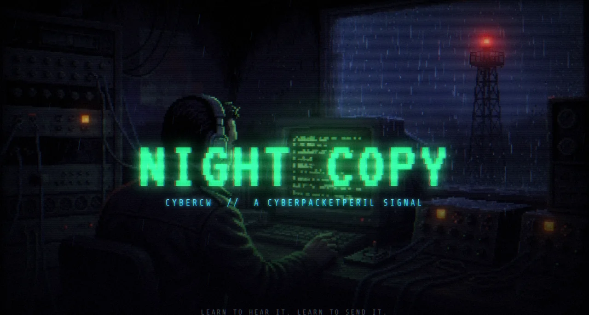
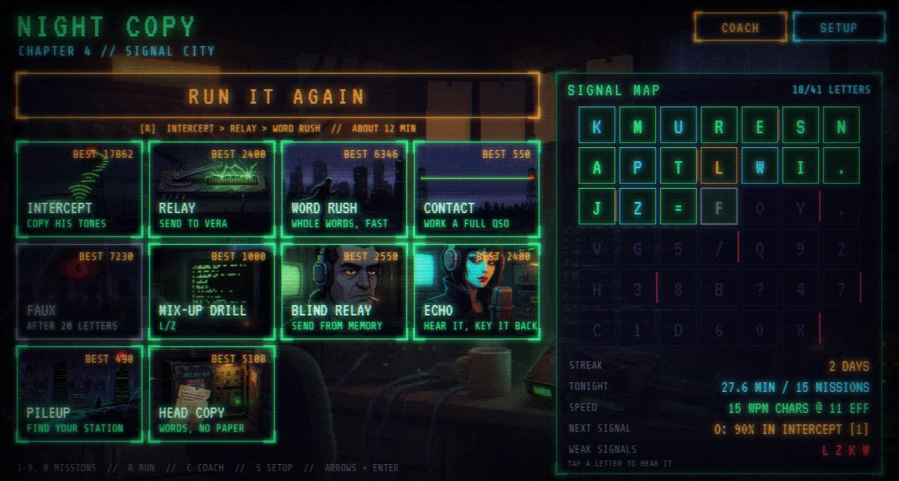
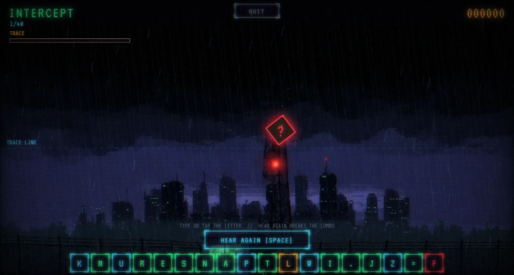
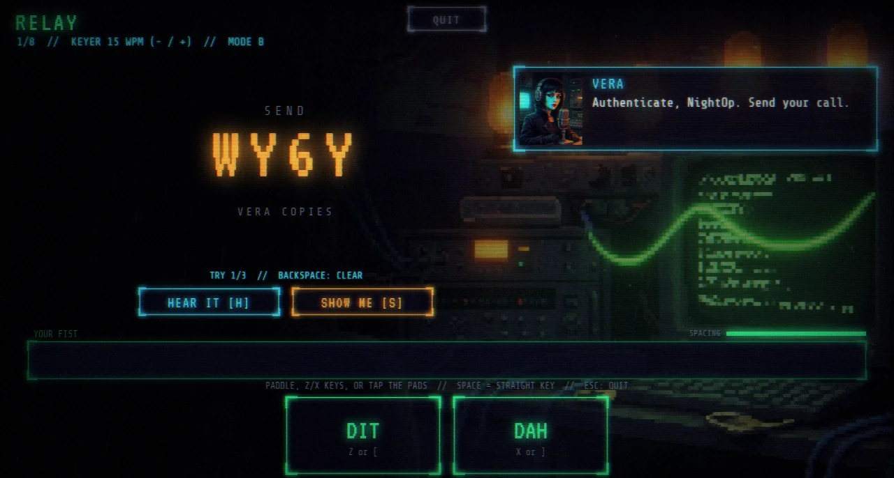
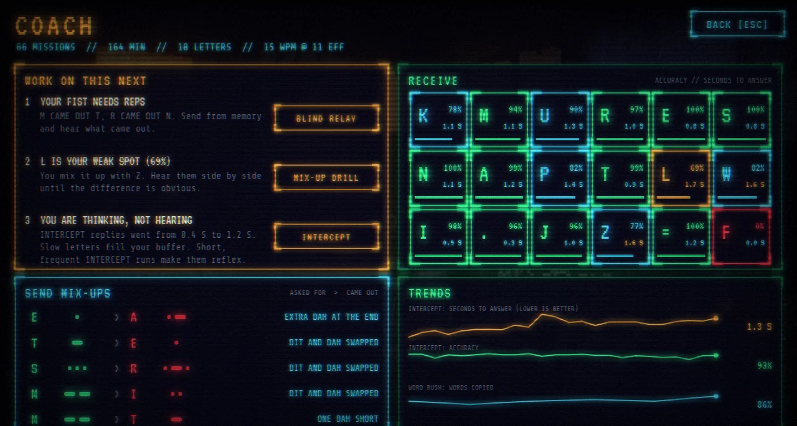

# Night Copy

A Morse code (CW) trainer game for Windows, macOS and Linux. You learn to hear letters at real speed (Koch
method, Farnsworth spacing), then send them, through a short noir campaign of
arcade missions: INTERCEPT, RELAY, WORD RUSH, CONTACT, and the FAUX boss at
the end of each chapter.

| | |
|---|---|
|  |  |
| The hub: missions, your Signal Map of learned letters, streak | INTERCEPT: hear the packet's letter, type it before it lands |
|  |  |
| RELAY: send to Vera on the keyboard, touch pads, or a real paddle | COACH: weak letters, slow letters, sending faults, trends |

## Install (Windows 10/11)

1. Open [Releases](../../releases) and download `Night.Copy_x.y.z_x64-setup.exe`.
2. Run it. The installer is not code-signed, so Windows may show **"Windows
   protected your PC"**. Click **More info**, then **Run anyway**.
3. Start **Night Copy** from the Start menu. On first run it asks for your
   callsign (your name is fine if you don't have one).

It installs for your user only (no admin prompt). Progress is saved in
`%APPDATA%\net.wy6y.nightcopy\`. Uninstall from Settings > Apps.

## Install (macOS 11 or later, Apple Silicon or Intel)

1. From [Releases](../../releases), download `Night.Copy_x.y.z_universal.dmg`,
   open it, and drag **Night Copy** to Applications.
2. The app isn't notarized by Apple, so the first launch is blocked. Open it
   once (it will say it can't be opened), then go to **System Settings >
   Privacy & Security**, scroll down, and click **Open Anyway** next to
   Night Copy. After that it opens normally.
3. For a MIDI paddle on a Mac, see [A real paddle](#a-real-paddle).

Progress is saved in `~/Library/Application Support/net.wy6y.nightcopy/`.

## Install (Linux, x86_64)

From [Releases](../../releases), either:

- `Night.Copy_x.y.z_amd64.AppImage`: `chmod +x` it and run it, or
- `Night.Copy_x.y.z_amd64.deb` (Debian, Ubuntu, Mint): `sudo apt install ./Night*.deb`.

Progress is saved in `~/.local/share/net.wy6y.nightcopy/`.

## A real paddle

Build the USB adapter in [WY6Y/cw-paddle-pico](https://github.com/WY6Y/cw-paddle-pico)
(a Raspberry Pi Pico 2, a 3.5 mm jack, three wires; prebuilt firmware and a
printable case), or use any USB MIDI device named "... CW Paddle" that sends
Note 20 for dit and Note 21 for dah.

- **Windows:** SETUP > CONNECT PADDLE.
- **macOS and Linux:** the app's built-in web engine (WebKit) has no Web MIDI.
  With Night Copy running, open `http://127.0.0.1:51600/` in Chrome or Edge
  and play there (same saved progress), then SETUP > CONNECT PADDLE. Leave the
  app's own window on the title screen.

## Playing

- Headphones help. Start with INTERCEPT: hear a letter, type it.
  90% over 30+ letters unlocks the next one.
- Sending (RELAY, CONTACT): `Z` / `[` dit, `X` / `]` dah, Space as a straight
  key, `-` / `+` keyer speed, `H` to hear the target, or a real paddle (below).
- SETUP (`S` on the hub) has speed, tone, volumes and your callsign.
  `F11` toggles fullscreen. `Esc` leaves a mission.

## Layout

| Path | What |
|---|---|
| `core/` | Rust timing core, built to `web/core.wasm`: CW renderer, iambic keyer, decoder, Koch scheduler |
| `server/` | Rust library (axum + SQLite): progress, session log, static files |
| `web/` | The game (WebGL2, Web Audio) |
| `desktop/` | Tauri v2 app: runs the server on 127.0.0.1 and opens a WebView2 window |

## Build

The packages are built by GitHub Actions on Windows, macOS and Linux: push a
tag `vX.Y.Z` (matching `version` in `desktop/tauri.conf.json`) and the
workflow attaches the `.exe`, `.dmg`, `.AppImage` and `.deb` to a Release.
Locally:

    cd desktop
    npx @tauri-apps/cli@2 build

Rebuild the core after changing it:

    cd core && cargo build --release --target wasm32-unknown-unknown
    copy target\wasm32-unknown-unknown\release\cybercw_core.wasm ..\web\core.wasm

See `CREDITS.md` for music, fonts and art. Copyright WY6Y, all rights reserved.
